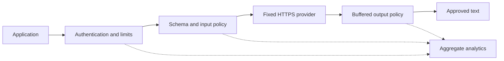

# LLM monitoring and policy proxy

See the [implementation backlog](LLM_PROXY_BACKLOG.md) for completed work and prioritized pending items.

## Design and implementation approaches

Place a gateway between application servers and model providers. Authenticate callers,
validate the complete conversation, apply input policy, call a fixed upstream,
validate and screen its response, then release only approved text. Keep provider
credentials on the gateway and restrict application network access to prevent bypass.

| Approach | Benefits | Tradeoffs |
| --- | --- | --- |
| In-process wrapper | Simple local model integration, minimal latency | Each application must enforce the wrapper; harder to centralize policy |
| Dedicated HTTP gateway (implemented) | Shared enforcement, provider abstraction, centralized analytics | Additional hop and operational dependency |
| Existing gateway plus policy hooks | Routing and operational features available sooner | Verify hook coverage, data retention and failure behavior before adoption |



The implementation is a standalone FastAPI application in `src/llm_proxy.py`.
The Gradio chatbot can opt into this gateway for generative fallback. An upstream adapter accepts a text
chat completion request and expects one assistant message plus provider token usage.
This is a narrow chat-shaped API, not full compatibility with any provider SDK.

## Policy and trust boundaries

- A client bearer key authorizes generation; a separate administrator key reads analytics.
- Configuration fixes the HTTPS upstream and model allowlist. Client headers and provider
  metadata are never passed through. Redirects and environment HTTP proxies are disabled.
- Only user and assistant text messages are accepted. Unknown fields, system-role
  overrides, streaming, tools and multimodal inputs are rejected.
- Every message and the joined history are screened using the repository's Unicode,
  PII, secret, unsafe markup and injection patterns. These are baseline heuristics:
  false positives and missed attacks are expected. They are not proof of safety.
- Request bodies are capped at 64 KiB, upstream bodies at 256 KiB; message counts,
  text lengths and generation token limits are bounded. There is a total upstream
  deadline, upload deadline, bounded concurrent requests and a per-process fixed-window
  rate limit for the configured client. Capacity is released on success, error or cancellation.
- Output is buffered and screened before delivery. Invalid responses and upstream
  failures produce generic errors. No provider error body is returned.
- Usage is counted before output screening so blocked generations remain visible.
  Provider-reported usage is not independently verified. Failures without valid usage
  can incur unreported provider charges; these counters are not a billing ledger.

Prompt-injection screening is only one layer. Enforce authorization at downstream
resource/tool boundaries and render text safely. See the
[OWASP guidance](https://cheatsheetseries.owasp.org/cheatsheets/LLM_Prompt_Injection_Prevention_Cheat_Sheet.html).
Tests use an injected HTTP transport, so no live model, secrets or paid calls are needed;
FastAPI also supports [dependency overrides](https://fastapi.tiangolo.com/advanced/testing-dependencies/)
for future adapter dependencies.

## Run locally

Python 3.10+:

```bash
pip install -r requirements-proxy.txt
export PROXY_CLIENT_KEY='replace-with-random-client-secret'
export PROXY_ADMIN_KEY='replace-with-different-random-admin-secret'
export PROXY_UPSTREAM_KEY='your-provider-credential'
export PROXY_UPSTREAM_URL='https://your-provider.example/v1/chat/completions'
export PROXY_MODELS='your-model-id'
uvicorn src.llm_proxy:app_from_env --factory --host 127.0.0.1 --port 8080
```

```bash
curl http://127.0.0.1:8080/v1/chat/completions \
  -H "Authorization: Bearer $PROXY_CLIENT_KEY" \
  -H 'Content-Type: application/json' \
  -d '{"model":"your-model-id","messages":[{"role":"user","content":"Where is my order?"}],"max_tokens":128}'
curl http://127.0.0.1:8080/analytics -H "Authorization: Bearer $PROXY_ADMIN_KEY"
```

Analytics include request outcomes, input/output block categories, upstream attempts,
prompt/completion token totals and cumulative request latency. Divide cumulative latency
by request count for average latency; percentiles are not provided. Daily history is
available when SQLite persistence is enabled.
Only aggregate counters are retained, never prompts, responses or credentials. Optional
SQLite persistence stores daily aggregates; process counters remain available separately.
Request IDs correlate responses without storing conversation data.

```bash
pip install -r requirements-dev.txt
python -m pytest tests/test_llm_proxy.py -q
ruff check src/llm_proxy.py tests/test_llm_proxy.py --select E,F,W --ignore E501
```

## Production progression

This single-client service uses process-local live counters and rate limits, which
reset on restart and are not shared across workers. Optional SQLite daily aggregates
survive restarts and support atomic updates from workers on the same host. Run one worker for its stated
semantics. Before scaling, add authenticated tenant identities, Redis atomic quotas,
centralized analytics for multiple hosts, and richer time-series metrics. Add per-model
pricing with versioned rates if cost estimates are needed; token totals alone are not cost.

Terminate TLS at an ingress with body/time/concurrency limits (including slow uploads),
limit outbound destinations, rotate credentials through a secret manager, and ensure
access logs/tracing do not capture Authorization headers or request/response bodies.
The service owns a pooled HTTP client through its application lifespan and closes it
on shutdown. It rejects excess concurrent requests with 503 and Retry-After; rate
limits return 429 and Retry-After. Add circuit breaking under sustained provider failures
and avoid blind retries of billable generation requests.

Version policy configuration, add application-specific moderation and PII detection,
measure false positives on legitimate traffic, and maintain an adversarial evaluation
set. Extend tests with sustained load, quota boundaries,
encoded and cross-message attacks, policy-engine failures, and multi-tenant isolation
before enabling those production features. Any future streaming design must define
how to avoid releasing unsafe text before the policy decision.

## Operational controls

| Environment variable | Default | Purpose |
| --- | --- | --- |
| `PROXY_REQUESTS_PER_MINUTE` | 60 | Per-process fixed-window client quota |
| `PROXY_MAX_CONCURRENT_REQUESTS` | 16 | Concurrent authenticated requests, including uploads |
| `PROXY_TIMEOUT_SECONDS` | 30 | Total upstream deadline |
| `PROXY_UPLOAD_TIMEOUT_SECONDS` | 10 | Maximum time to receive the request body |

`GET /health/live` reports that the process serves requests. `GET /health/ready`
returns 200 when the pooled client is initialized, and 503 otherwise; it does not
call the model provider or guarantee provider availability. Both expose no credentials.

Tests cover concurrent admission, cancellation recovery, slow uploads, total upstream
deadlines, pooled client cleanup, and policy exceptions. Unexpected exceptions return
a generic 500 and increment the internal-error counter; prompt contents and exception
messages are not recorded.

## Persistent usage reports

Set `PROXY_ANALYTICS_DB=/path/to/proxy-usage.db` to enable SQLite daily aggregates.
The parent directory must already exist and be writable; startup fails if the configured
database cannot initialize. Leave the variable unset for in-memory counters only.
`PROXY_ANALYTICS_RETENTION_DAYS` defaults to 90 and must be positive.

```bash
curl 'http://127.0.0.1:8080/analytics/history?days=7' \
  -H "Authorization: Bearer $PROXY_ADMIN_KEY"
```

The admin-only endpoint returns `totals` and `daily` maps for a UTC calendar-day
window including today. `days` must be between 1 and the configured retention.
The existing `/analytics` endpoint continues to return process-lifetime counters.

Each completed request contributes one atomic transaction containing outcome, block
categories, reported tokens, and latency. Cancellation has its own outcome. Writes wait up to five seconds for SQLite locks and
run in worker threads and finish before the response returns; the latency metric
excludes database write time. SQLite WAL supports multiple local worker processes;
do not share this database over a network filesystem. Use a managed database or
metrics collector for multiple hosts.

Records outside retention are deleted during writes. Reporting excludes expired
rows even during idle periods; physical deletion waits for the next write. Aggregate
rows contain no request IDs, credentials, conversation text, or client-supplied labels.
Protect database files and backups with filesystem access controls.

If persistence fails at runtime, policy enforcement and response delivery continue,
and `/analytics` increments `analytics_write_errors`. History read failures return
a generic 503. Failed writes are not retried and abrupt termination can lose the
recent metrics (WAL uses synchronous=NORMAL), so reports are operational analytics, not a billing ledger.
Monitor write errors and use consistent retention settings across workers.

## Chatbot integration (PROXY-01)

Install proxy dependencies in the chatbot environment too. Start the gateway separately,
then configure the chatbot before starting `app.py`:

```bash
export ENABLE_GENERATIVE_FALLBACK=true
export USE_LLM_PROXY=true
export PROXY_BASE_URL=http://127.0.0.1:8080
export PROXY_CLIENT_KEY='same-client-secret-as-gateway'
export PROXY_MODEL='your-model-id'
export PROXY_TIMEOUT=60
```

Deterministic delivery, template and retrieval routes remain first. Only unresolved
requests use generation. The client forwards the last `MAX_HISTORY_TURNS` complete
user/assistant pairs and the current message, with the configured generation limit.
The gateway screens history and buffers generated output before delivery; the chatbot
also screens its final response. Denials, invalid responses and outages return safe
support messages without exposing provider errors. Rate limits ask the user to wait.
The client does not follow redirects, use environment HTTP proxies, or retry generation.

Generation stays disabled by default. With generation enabled and `USE_LLM_PROXY=false`,
the legacy local DialoGPT path remains available. With `USE_LLM_PROXY=true`, failures
never switch to DialoGPT or a direct provider. DialoGPT is not an upstream adapter for
this gateway; proxy mode requires the documented HTTPS chat-completion upstream.
Network restrictions preventing application bypass remain deployment work (PROXY-04).

`tests/test_chatbot_proxy.py` exercises the chat entry point through the actual gateway
with a mocked provider, including history rejection, output blocking with usage retained,
credential separation, invalid responses, outages and explicit local-mode selection.
